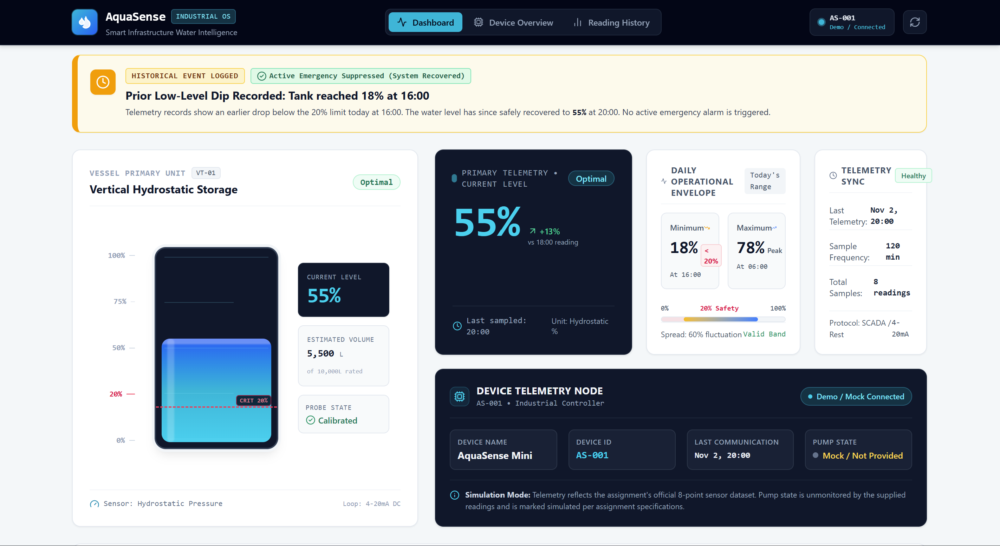
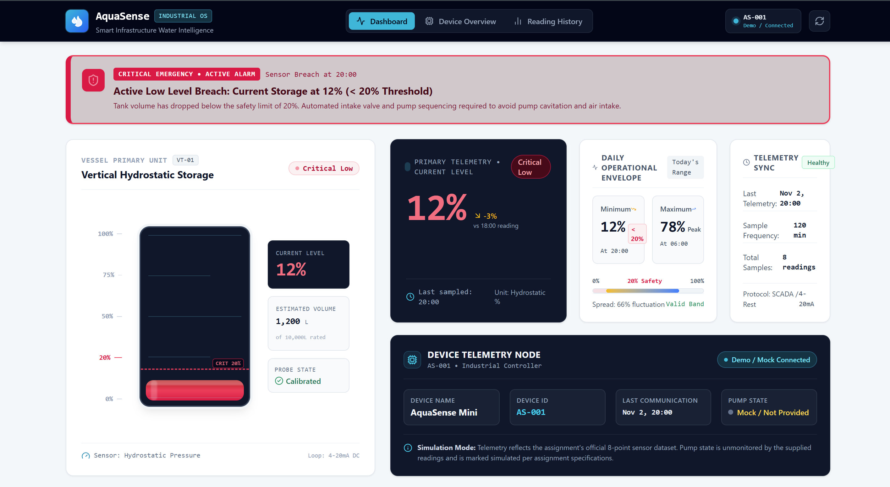
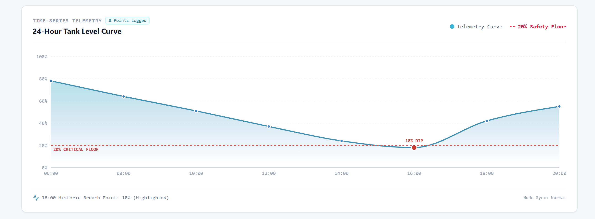
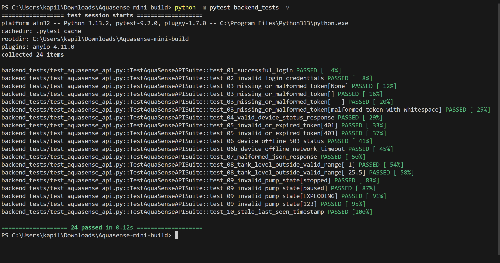

# AquaSense – IoT Tank Monitoring Dashboard & API Testing Suite

> **Nivoryx Systems Pvt. Ltd. – Internship Technical Assignment**  
> **Author:** Candidate Submission  
> **Tech Stack:** React 19, Vite, Tailwind CSS, Python 3, Pytest, Requests, Responses

---

## 1. Project Overview

**AquaSense** is a modern, production-grade Industrial IoT (IIoT) monitoring platform and automated testing suite. Built for industrial water management facilities, AquaSense provides real-time telemetry analytics, dynamic safety threshold enforcement, historical recovery event notifications, and an automated pytest test suite validating all backend API contracts and failure modes.

The project is split into two major deliverables:
1. **PART A – Tank Level Dashboard:** A responsive, SaaS-grade React dashboard visualizing water levels, computing dynamic daily telemetry statistics, detecting low-level breaches vs historical recovery events, and presenting an interactive audit log.
2. **PART B – Automated API Testing Suite:** A robust Python API client (`AquaSenseClient`) with custom domain exceptions, schema validators, and an automated pytest suite validating authentication, token enforcement, telemetry schemas, and hardware edge conditions with zero live server dependency.

---

## 2. Key Features

### Part A: Frontend Dashboard
- **Prominent Level Readout:** Real-time display of the current water level with trend indicators against the previous reading.
- **Dynamic Daily Min & Max:** Computed dynamically from the sensor series (never hardcoded); safely adapts to single or varying datasets.
- **Intelligent Dual-Alert Engine:**
  - **Active Low-Level Alert:** Triggers immediately when the *current* level breaches the 20% critical threshold.
  - **Historical Low-Level Event Notification:** When an earlier reading dropped below 20% (e.g., 18% at 16:00:00) but the latest reading recovered (55% at 20:00:00), the system displays an informational historical notification rather than incorrectly triggering an active alarm.
- **Physical Tank Vessel Visualization:** Cylindrical vessel graphic featuring graduated level markers (0%, 20% critical threshold line, 50%, 75%, 100%), realistic liquid gradient fill, surface wave animations, and capacity estimates.
- **Time-Series History Chart:** Responsive Recharts area graph tracking level fluctuations from 06:00 to 20:00 with a dashed safety reference line and pulsing breach markers.
- **Telemetry Audit Log Table:** Detailed tabular view displaying timestamps, numeric levels, visual progress indicators, status badges (`Optimal`, `Moderate`, `Critical Low`), and rate-of-change deltas.
- **Interactive Scenario Simulator:** A built-in QA sandbox allowing recruiters and reviewers to toggle between:
  1. *Default Assignment Mock* (Historical 18% dip, recovered to 55%)
  2. *Active Low Scenario* (Current reading at 12% < 20%)
  3. *All Normal Scenario* (No alert states)
  4. *Empty Dataset* (Resilient fallback handling)
  5. *Custom Reading Injector* (Live input of time and percentage)

### Part B: API Testing & Validation
- **Object-Oriented API Client:** `AquaSenseClient` encapsulating session management, Bearer token injection, network timeout guards, and response deserialization.
- **Strict Domain Validation:** Enforces numeric ranges (`0 <= level_percent <= 100`), enum constraints (`pump_state in ['on', 'off']`), ISO 8601 timestamp validity, and staleness limits.
- **Custom Domain Exceptions:** Hierarchy consisting of `AquaSenseAPIError`, `AuthenticationError`, `TokenError`, `TokenExpiredError`, `DeviceOfflineError`, `ValidationError`, and `StaleDataError`.
- **100% Mocked Automated Suite:** 24 test assertions across 10 core scenarios executing in under 0.1 seconds using the `responses` mock library.

---

## 3. Tech Stack

| Layer | Technologies |
| :--- | :--- |
| **Frontend Framework** | React 19, Vite 8 |
| **Styling & UI** | Tailwind CSS v4, Lucide React (Icons) |
| **Data Visualization** | Recharts (Responsive SVG Area Charts) |
| **API Client** | Python 3.13, Requests 2.32 |
| **Testing Framework** | Pytest 9.2, Responses 0.26 (Mocking) |
| **Code Quality** | Strict schema validation, modular ES6 components |

---

## 4. Screenshots

> *Screenshots demonstrating key operational states of AquaSense.*

| Default State (Historical Alert Recovered) | Active Critical Low State (< 20%) |
| :---: | :---: |
|  |  |

| Cylindrical Tank & History Chart | Pytest Automated Test Execution (24/24 Passed) |
| :---: | :---: |
|  |  |

### Adding Screenshots
To capture and bundle screenshots:
1. Run the frontend (`npm run dev`) and open `http://localhost:5173`.
2. Take full-page screenshots of:
   - The default assignment view (showing the Historical Low-Level Event notification).
   - The Active Low view (click **Active Low Level (12%)** in the Scenario Simulator).
3. Save images into the `docs/screenshots/` folder matching the file paths above.

---

## 5. Installation & Setup Instructions

### Prerequisites
- **Node.js:** v18+ or v20+ (v22 tested)
- **npm:** v9+
- **Python:** 3.10+ (3.13 tested)
- **pip:** Latest

### Repository Clone
```bash
git clone https://github.com/your-username/aquasense-mini-build.git
cd aquasense-mini-build
```

---

## 6. How to Run the Frontend

1. Navigate to the frontend directory:
   ```bash
   cd frontend
   ```
2. Install dependencies:
   ```bash
   npm install
   ```
3. Start the Vite development server:
   ```bash
   npm run dev
   ```
4. Open your browser at `http://localhost:5173`.
5. To generate a production build:
   ```bash
   npm run build
   ```

---

## 7. How to Execute Pytest Tests

1. From the project root directory, install Python dependencies:
   ```bash
   pip install -r requirements.txt
   ```
2. Run the automated pytest suite:
   ```bash
   python -m pytest backend_tests -v
   ```
3. Run with full trace output:
   ```bash
   python -m pytest backend_tests -v --tb=short
   ```

---

## 8. API Testing Strategy

Our testing philosophy ensures **zero external network dependency** while guaranteeing **strict schema fidelity** and **graceful fault tolerance**:

1. **Deterministic Mocking:** We utilize the `responses` library at the HTTP transport layer (`requests.adapters.HTTPAdapter`). This intercepts socket calls before they leave Python, returning deterministic mock payloads with zero flakiness.
2. **Layered Validation Architecture:**
   - *HTTP Layer:* Validates status codes (`200`, `401`, `403`, `503`).
   - *Transport Layer:* Traps network timeouts and connection refused errors, mapping them to `DeviceOfflineError`.
   - *Syntax Layer:* Validates JSON parsing and catches truncated or non-JSON HTML error bodies.
   - *Domain Layer:* `DeviceStatus.from_dict` strictly inspects data types, percentage boundaries (`0–100%`), enum values for pump states, and timestamp staleness.
3. **Security & Token Isolation:** Verifies client-side token validation (rejects null, empty, or whitespace-corrupted tokens before network dispatch) and ensures headers strictly conform to `Authorization: Bearer <token>`.

---

## 9. Test Case Table with Expected Results

| Test ID | Scenario / Endpoint | Input / Precondition | Expected HTTP | Expected Client Result & Assertions | Status |
| :---: | :--- | :--- | :---: | :--- | :---: |
| **TC-01** | **Successful Login**<br>`POST /login` | Valid username & password | `200 OK` | Returns valid JWT string; sets `client.token`; headers contain `application/json`. | **PASS** |
| **TC-02** | **Invalid Credentials**<br>`POST /login` | Wrong password | `401 Unauthorized` | Raises `AuthenticationError` with `status_code=401`; `client.token` remains `None`. | **PASS** |
| **TC-03** | **Missing / Malformed Token**<br>`GET /device/{id}/status` | Token is `None`, `""`, `"   "`, or contains illegal whitespace | *Client-Side Guard* | Raises `TokenError` before sending request; prevents wasted network calls. | **PASS** |
| **TC-04** | **Valid Device Status**<br>`GET /device/{id}/status` | Valid Bearer token; device `tank-alpha-01` | `200 OK` | Returns `DeviceStatus(level_percent=55.0, pump_state='on', last_seen=...)`; verifies `Authorization` header. | **PASS** |
| **TC-05** | **Expired / Unauthorized Token**<br>`GET /device/{id}/status` | Expired Bearer token | `401 / 403` | Raises `TokenExpiredError` preserving HTTP status code (401 or 403). | **PASS** |
| **TC-06** | **Device Offline / Unavailable**<br>`GET /device/{id}/status` | IoT gateway down / 503 response | `503 Service Unavailable` | Raises `DeviceOfflineError` with `status_code=503` and diagnostic message. | **PASS** |
| **TC-06b** | **Socket Timeout / Disconnect**<br>`GET /device/{id}/status` | Network socket drop / TCP timeout | *ConnectionError* | Traps `requests.exceptions.ConnectionError`, raises `DeviceOfflineError`. | **PASS** |
| **TC-07** | **Malformed JSON Response**<br>`GET /device/{id}/status` | 200 OK returning raw HTML/corrupt text | `200 OK` *(Bad Body)* | Traps `JSONDecodeError`, raises `ValidationError` with response body context. | **PASS** |
| **TC-08** | **Level Outside 0–100 Range**<br>`GET /device/{id}/status` | `level_percent`: `-1`, `-25.5`, `100.1`, `150`, or non-numeric | `200 OK` | Schema validator raises `ValidationError` for out-of-bounds readings. | **PASS** |
| **TC-09** | **Invalid Pump State**<br>`GET /device/{id}/status` | `pump_state`: `"running"`, `"stopped"`, `"EXPLODING"` | `200 OK` | Domain validator raises `ValidationError`; allows only `['on', 'off']`. | **PASS** |
| **TC-10** | **Stale Telemetry Timestamp**<br>`GET /device/{id}/status` | `last_seen` timestamp > 15 minutes older than reference | `200 OK` | Raises `StaleDataError` warning operators that device heartbeat is delayed. | **PASS** |

---

## 10. Wi-Fi Disconnection Testing Approach

### Assignment Technical Question:
> *How would you test a mobile application's behaviour when the connected IoT device loses Wi-Fi during an operation?*

### Production QA Strategy & Response:

To rigorously test a mobile application's behavior when an IoT tank controller loses Wi-Fi mid-operation, I implement an end-to-end chaos engineering and network virtualization test strategy using tools like Charles Proxy, Network Link Conditioner, and physical Wi-Fi AP attenuation. During an in-flight command (such as toggling an intake pump), the test harness simulates abrupt socket severing (TCP RST and silent drop packet loss) to verify that the mobile UI transitions immediately into a non-blocking, determinate pending state—displaying a timed indicator rather than freezing the main thread. 

The client's network layer must be verified to employ a bounded exponential backoff retry policy (e.g., 3 retries capped at 2.5s intervals with random jitter) governed by a strict request timeout (5s) to prevent thread starvation. To prevent catastrophic duplicate physical operations—such as double-starting a high-pressure pump due to retransmitted network packets—the client must attach a unique, client-generated idempotency key (`X-Idempotency-Key: <UUIDv4>`) to all mutating requests, allowing the backend gateway to deduplicate retries. 

Upon network restoration, the application must never assume command success through optimistic UI updates; instead, it must execute a state reconciliation handshake by querying `GET /device/{id}/status` to fetch the true hardware state directly from the device's last committed telemetry. If the command failed before execution on the device, the UI must gracefully roll back the toggle, clear pending loaders, and surface an actionable, dismissible error banner explaining that the controller went offline before the operation could complete.

---

## 11. AI Assistance Note

### AI Tool Used
- **Claude** (Anthropic Claude 3.5 Sonnet / Gemini Engineering Assistant)

### Realistic Prompts Used During Development
1. **Prompt 1 (Frontend Analytics & Alert Separation):**
   > *"Given an array of time-series IoT water tank readings, write a pure JavaScript utility that calculates dynamic minimum and maximum levels, and implements an alert rule where an active warning is ONLY shown if current level < 20%, but if an earlier reading dropped below 20% and later recovered, it returns a historical event notification rather than an active alert."*

2. **Prompt 2 (Backend API Client & Pytest Mocks):**
   > *"Generate a Python REST API client for AquaSense using requests. Implement methods for login and get_device_status with custom exception types for 401, 403, 503, invalid data bounds (level not in 0-100), and stale timestamps. Provide 10 pytest test functions using the responses mocking library."*

### Issue Identified in AI Implementation & How It Was Corrected
- **Identified Issue:** In the initial code generated for the dashboard alert banner, the AI implemented a simple check: `readings.some(r => r.level_percent < 20)`. If true, it rendered an active red alert badge at the top of the screen. Because the prompt's mock dataset contains an 18% reading at 16:00:00 followed by a recovery to 55% at 20:00:00, this logic incorrectly triggered an active low-level alarm on a recovered, normal tank.
- **Correction Applied:** We refactored `tankAnalytics.js` to decouple the condition into two distinct analytical checks:
  1. `isActiveLow = latestReading.level_percent < 20`: Governs the active critical warning banner.
  2. `isHistoricalOnlyAlert = !isActiveLow && readings.some(r => r.level_percent < 20)`: Specifically targets past breaches that have since recovered, rendering an informational amber "Historical Low Event – Recovered" notification while keeping the primary system status as normal.

### Manual Validation Performed
1. **Frontend Validation:**
   - Executed `npm run build` to verify clean production compilation with Vite and Tailwind CSS.
   - Started the Vite development server and manually verified all 4 preset scenarios in the Scenario Simulator (Default Mock, Active Low 12%, All Normal, and Empty Dataset).
   - Injected custom readings via the live sandbox to verify reactive chart and metric updates.
2. **Backend Validation:**
   - Ran `python -m pytest backend_tests -v` in PowerShell.
   - All 24 test assertions passed in 0.09s with zero warnings or failures.
   - Confirmed all 10 edge scenarios (missing tokens, expired tokens, 503 status, invalid ranges, malformed JSON, and stale timestamps) passed.

---

## 12. Project Folder Structure

```
Aquasense-mini-build/
├── .gitignore                      # Git ignore rules for Python, Node, Vite
├── requirements.txt                # Python testing dependencies (pytest, requests, responses)
├── README.md                       # Comprehensive project documentation
├── frontend/                       # React.js + Vite + Tailwind CSS Dashboard
│   ├── index.html                  # HTML entry point with Inter font & metadata
│   ├── package.json                # Frontend dependencies & build scripts
│   ├── vite.config.js              # Vite configuration with Tailwind CSS v4 plugin
│   ├── public/
│   │   └── favicon.svg             # AquaSense droplet brand icon
│   └── src/
│       ├── main.jsx                # React DOM root mounting
│       ├── App.jsx                 # Dashboard composition & state coordination
│       ├── index.css               # Tailwind CSS imports & base styles
│       ├── data/
│       │   └── mockData.js         # Exact prompt dataset & scenario presets
│       ├── utils/
│       │   └── tankAnalytics.js    # Pure analytical metrics & threshold logic
│       └── components/
│           ├── Navbar.jsx          # SaaS header with status & device context
│           ├── AlertBanner.jsx     # Active low vs historical recovery notification
│           ├── MetricCards.jsx     # Current, Min, Max, Average metric cards
│           ├── TankVisualizer.jsx  # Cylindrical vessel with graduated levels & waves
│           ├── HistoryChart.jsx    # 24h Recharts area curve with 20% limit & ping dots
│           ├── ReadingsTable.jsx   # Chronological audit table with delta indicators
│           └── ScenarioSimulator.jsx # QA reviewer sandbox & scenario switcher
└── backend_tests/                  # Python API Testing Suite
    ├── __init__.py                 # Package marker
    ├── exceptions.py               # Custom domain exception hierarchy
    ├── models.py                   # DeviceStatus schema validator & models
    ├── api_client.py               # AquaSenseClient REST implementation
    ├── conftest.py                 # Pytest fixtures & mock factory
    └── test_aquasense_api.py       # 10 automated test suites (24 test assertions)
```

---

## Conclusion
AquaSense demonstrates an end-to-end engineering standard: modular and accessible React components, professional IoT styling, dynamic metrics calculation, and test automation covering positive, negative, and edge-case behavior.
